# CineBL

**English** | [简体中文](README.zh-CN.md)

CineBL is a film camera app for iPhone. Import your photos and give them a film look in two ways: **Film** keeps the photo itself, with a film-style look and an optional date stamp; **Photo Paper** turns it into a print you can sign by hand. Camera capture and more features are on the way. Stay tuned.

  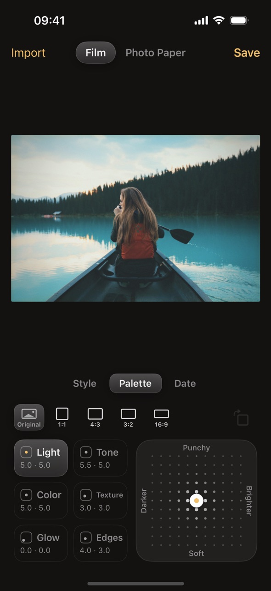
  
  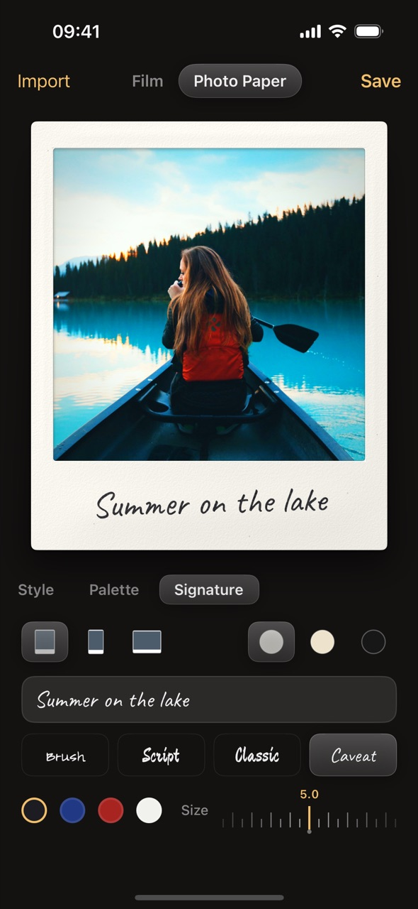

## How It Works

1. Tap **Choose Photo** or **Import** in the top-left corner and pick one photo, or up to 20 at once.
2. Choose **Film** or **Photo Paper** at the top.
3. Pick a style, fine-tune the look in the palette, and crop by dragging and pinching inside the photo. Double-tap to reset the crop.
4. Touch and hold the photo to compare it with the original.
5. Tap **Save**. If you imported several photos, save them all at once or just the current one.

<table>
  <tr>
    <td align="center">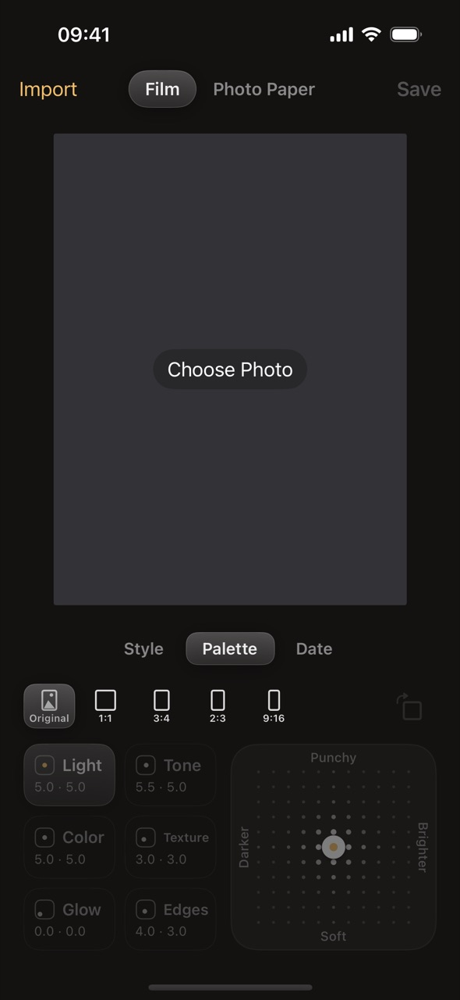 Before choosing a photo</td>
  </tr>
</table>

## Two Modes

Film and Photo Paper share the same photos, style and adjustments, so you can switch back and forth at any time to compare them.

<table>
  <tr>
    <td align="center"> Film</td>
    <td align="center">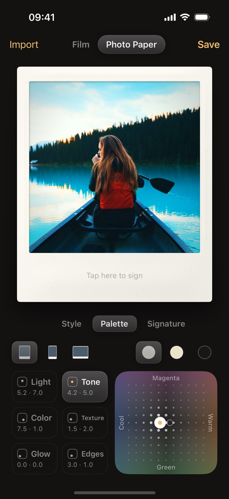 Photo Paper</td>
  </tr>
</table>

## Styles

12 built-in styles. Each one is shown on its own sample photo, so you can see the look before you apply it. Choosing a style sets the whole look at once, and you can keep fine-tuning it in the palette.

<table>
  <tr>
    <td align="center">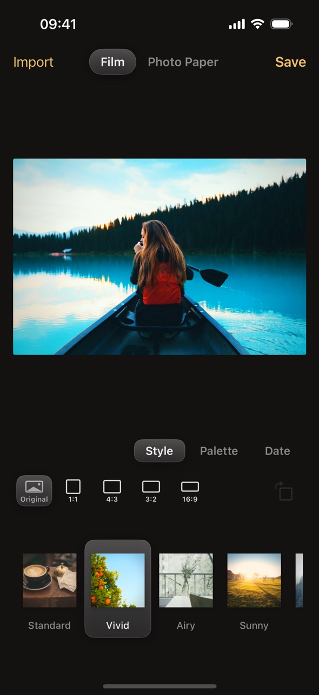 The Style page with Vivid selected</td>
  </tr>
</table>

<table>
  <tr>
    <td>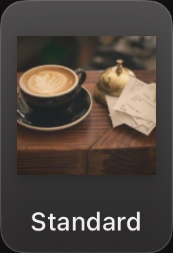</td>
    <td>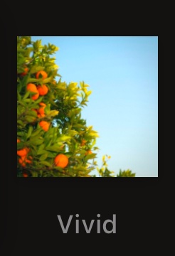</td>
    <td>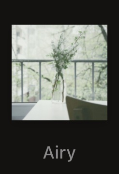</td>
    <td>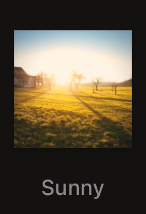</td>
    <td>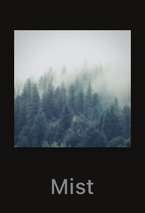</td>
    <td>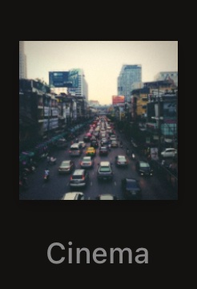</td>
  </tr>
  <tr>
    <td>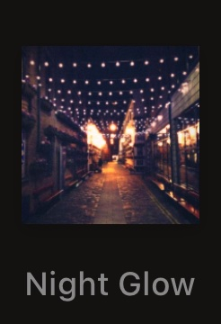</td>
    <td>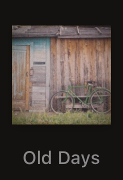</td>
    <td>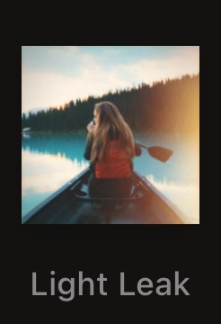</td>
    <td>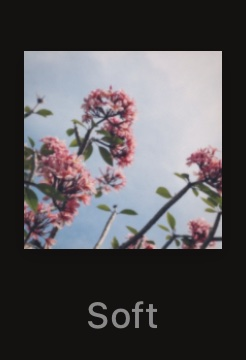</td>
    <td>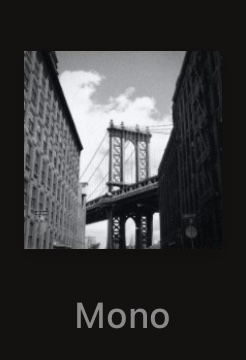</td>
    <td>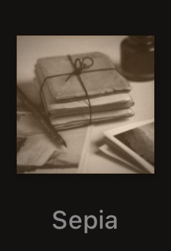</td>
  </tr>
</table>

| Style | Look |
| --- | --- |
| Standard | Classic photo paper colors: soft blacks, slightly cyan shadows, warm highlights |
| Vivid | Cool white balance, rich colors, punchy contrast |
| Airy | Slightly bright, low contrast and saturation, a hint of cyan-green |
| Sunny | Golden warm tones with a little glow in the highlights |
| Mist | Cool, faded, soft and hazy |
| Cinema | Punchy contrast, teal shadows, warm highlights |
| Night Glow | A red-orange halo around lights, cool shadows |
| Old Days | Like expired film: low contrast, a pink-orange cast, blotchy edges |
| Light Leak | Red-orange light leaking in from one side |
| Soft | Soft focus with a glow, pastel tones |
| Mono | Cool black and white with strong grain |
| Sepia | Warm brown monochrome, like a photo kept for many years |

## Palette

Twelve adjustments in six pairs, each pair on a touch pad. One adjustment runs left to right and the other bottom to top, so a single drag changes both.

| Group | Left → right | Bottom → top |
| --- | --- | --- |
| Light | Exposure: Darker → Brighter | Contrast: Soft → Punchy |
| Tone | Warmth: Cool → Warm | Tint: Green → Magenta |
| Color | Saturation: Mono → Vivid | Fade: Crisp → Faded |
| Texture | Softness: Sharp → Dreamy | Grain: Fine → Grainy |
| Glow | Halation: None → Halo | Light Leak: None → Leak |
| Edges | Vignette: Clear → Dark | Edge Stain: Clean → Stained |

- Touch anywhere on the pad and both values follow your finger.
- The knob snaps to the default point, with a light haptic tick at each step.
- Double-tap the pad to reset the group.

<table>
  <tr>
    <td align="center"> Light</td>
    <td align="center">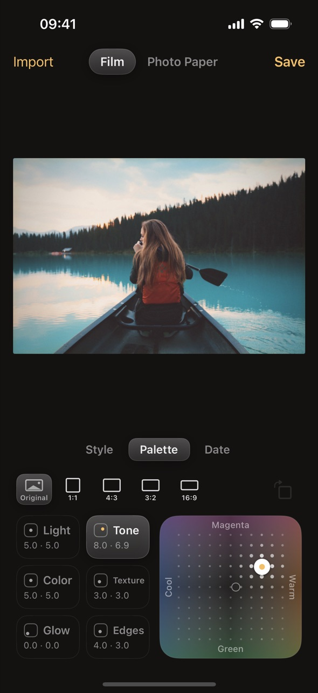 Tone</td>
  </tr>
</table>

## Film

The default mode. The photo fills the frame, and what you save is the photo itself with the look applied.

### Aspect Ratio

Original, 1:1, 4:3, 3:2 or 16:9. Ratios follow the photo's orientation, and the button at the right end of the row switches between portrait and landscape.

<table>
  <tr>
    <td align="center">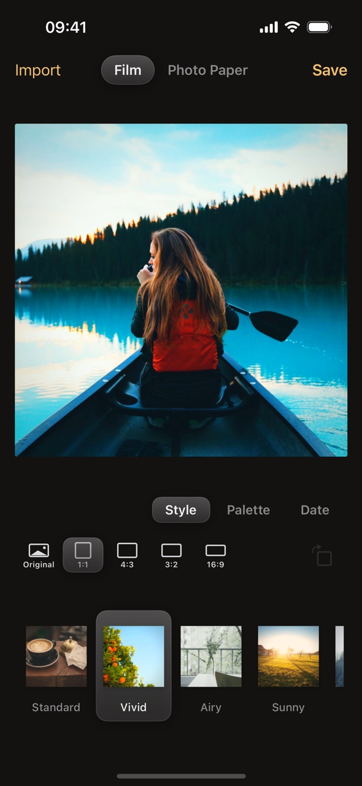 1:1</td>
  </tr>
</table>

### Date Stamp

Like the date back on an old film camera: a glowing seven-segment date in the bottom-right corner.

- Print the date the photo was taken, or today's date. If a photo has no date taken, today's date is used.
- Three orders: '26 11 22, 11 22 '26 and 22 11 '26.
- Orange, red or yellow.
- The line at the bottom of the page shows exactly what will be printed.

<table>
  <tr>
    <td align="center"> The Date page</td>
  </tr>
</table>

  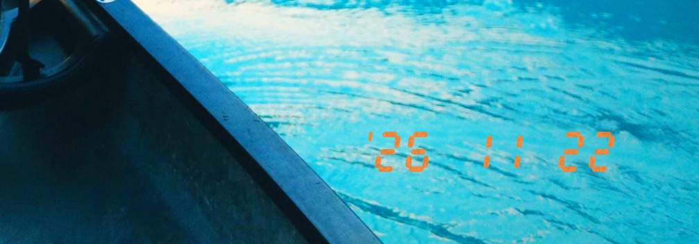 
  The date stamp on a saved photo at full size

### Compare with the Original

Touch and hold the photo to see the original. Let go to go back.

<table>
  <tr>
    <td align="center">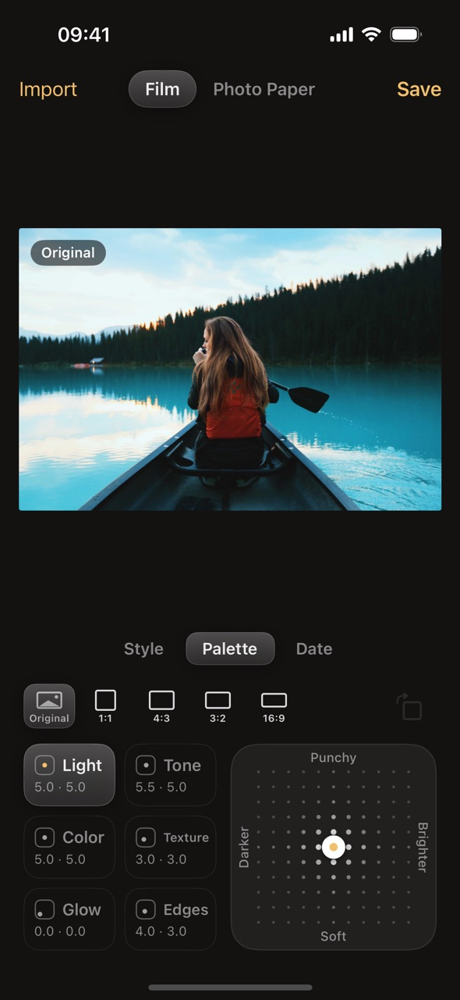 Touch and hold</td>
  </tr>
</table>

### Saved Photo

The processed photo at high resolution, with the date it was taken and its location kept, so it sits next to the original in your library.

  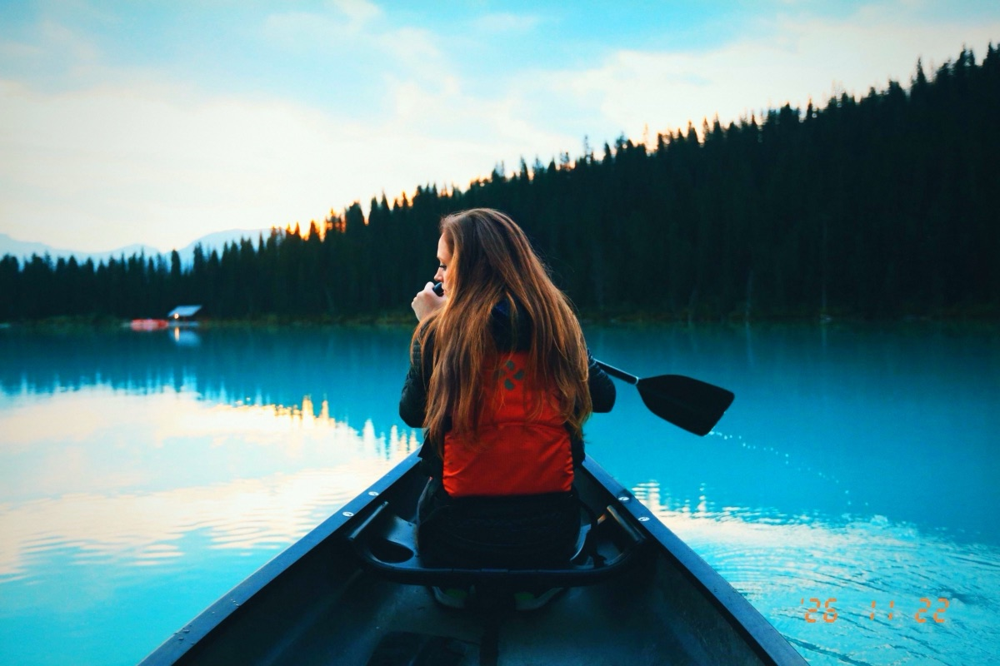

## Photo Paper

The photo goes into the window of a print, with a strip at the bottom to sign.

### Format and Paper

Three formats (square, portrait, landscape) and three paper colors (white, cream, black). On black paper, black ink switches to white automatically.

<table>
  <tr>
    <td align="center">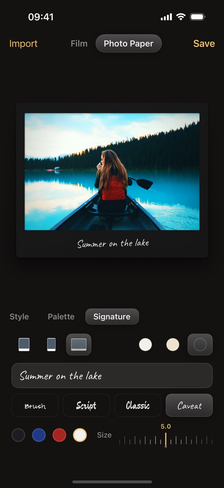 Landscape format on black paper</td>
  </tr>
</table>

### Signature

Write a line on the bottom strip of the paper, as you would with a pen.

- Tap the blank strip on the paper, or switch to Signature.
- Choose from four handwriting fonts and four ink colors (black, blue, red, white), and set the size with the ruler.
- While you type, only the text field moves up above the keyboard; the rest of the page stays where it is.

<table>
  <tr>
    <td align="center">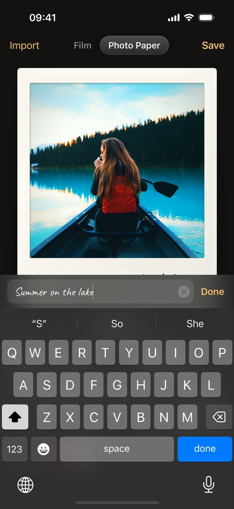 Typing</td>
    <td align="center"> Font, ink and size</td>
  </tr>
</table>

### Paper Detail

The paper is modeled on real photo paper: a satin-matte frame, a window with slightly rounded corners and an inner shadow, and a glossy picture area. The detail holds up at full size.

  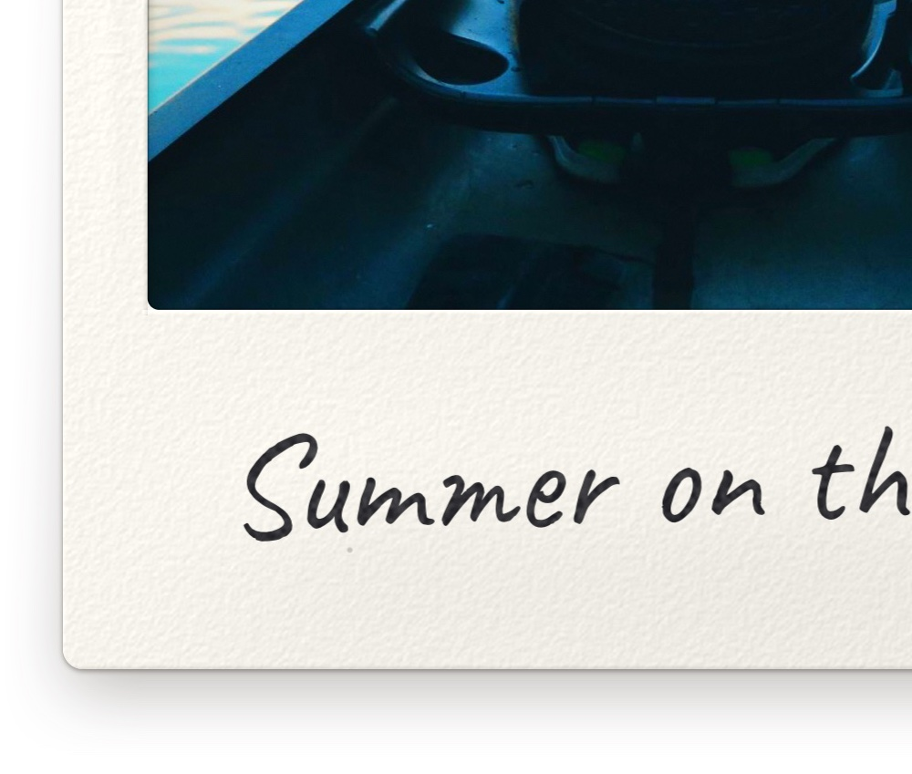 
  The bottom-left corner of a saved print at full size

### Saved Print

The saved image shows the print lying on a white table, with rounded corners and a soft shadow, at high resolution.

  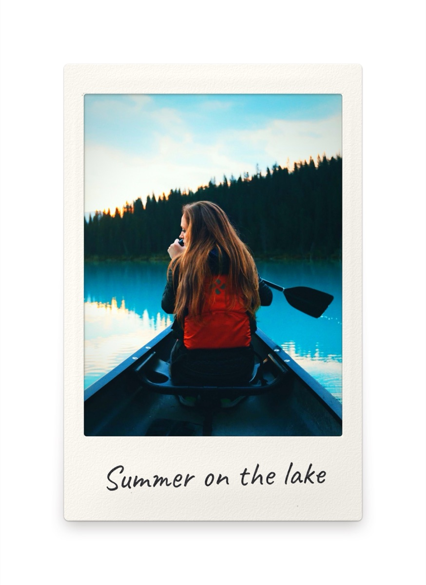

## Batch Import

Import up to 20 photos at once. They appear in a strip below the photo; tap one to edit it. The mode, style, adjustments and date stamp apply to all of them, and each photo keeps its own crop. When you save, choose to save them all or just the current one.

<table>
  <tr>
    <td align="center">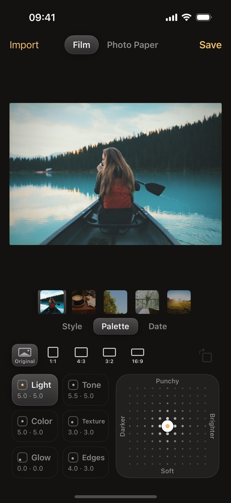 Several photos at once</td>
  </tr>
</table>

## Languages

CineBL is available in English and Simplified Chinese and follows your iPhone's language: Simplified Chinese shows Chinese, and every other language shows English. You can also choose a language for CineBL alone in Settings → CineBL → Language.

<table>
  <tr>
    <td align="center"> English</td>
    <td align="center">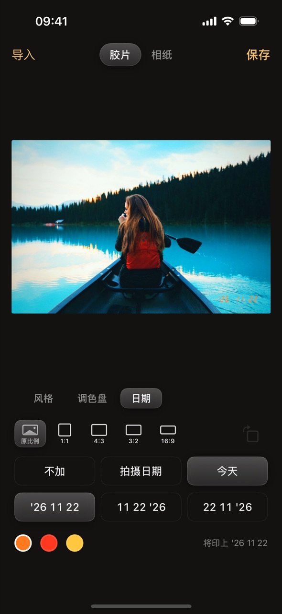 Simplified Chinese</td>
  </tr>
</table>

## Privacy

CineBL needs no account and collects no data. Photos are chosen with the system photo picker, so the app never reads your photo library. It asks only for permission to add photos, when you save. Saved photos keep the original date taken and location.

## Requirements

iPhone with iOS 16.0 or later.
