# CineBL

[English](README.md) | **简体中文**

CineBL 是一款 iPhone 胶片相机 App。导入照片后有两种玩法：**胶片**保留照片本身，套上胶片色彩，还可以印上日期；**相纸**把照片做成一张可以手写签名的相纸。相机拍摄等更多功能正在开发中，敬请期待。

  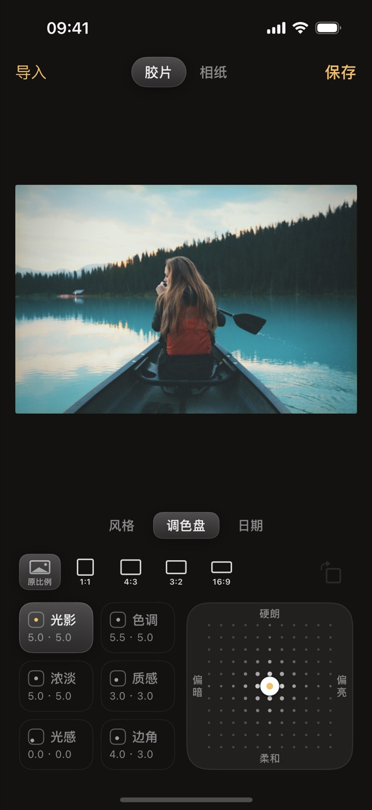
  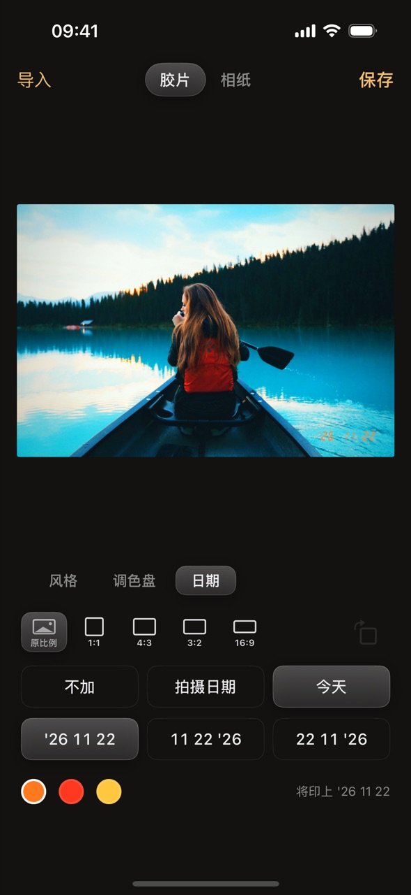
  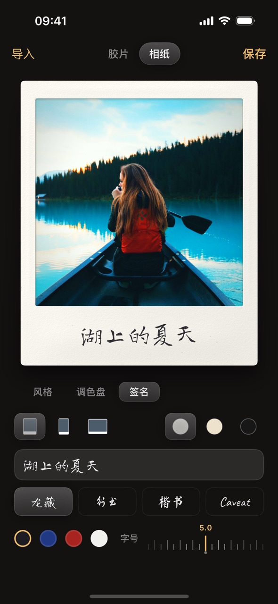

## 使用方法

1. 点「选择照片」或左上角的「导入」，选一张照片，也可以一次选最多 20 张。
2. 在顶部选「胶片」或「相纸」。
3. 挑风格、在调色盘里微调，在照片上拖动、双指缩放来裁切，双击复位。
4. 按住照片可以和原图对比。
5. 点「保存」。一次导入了多张时，可以全部保存，也可以只存当前这张。

<table>
  <tr>
    <td align="center">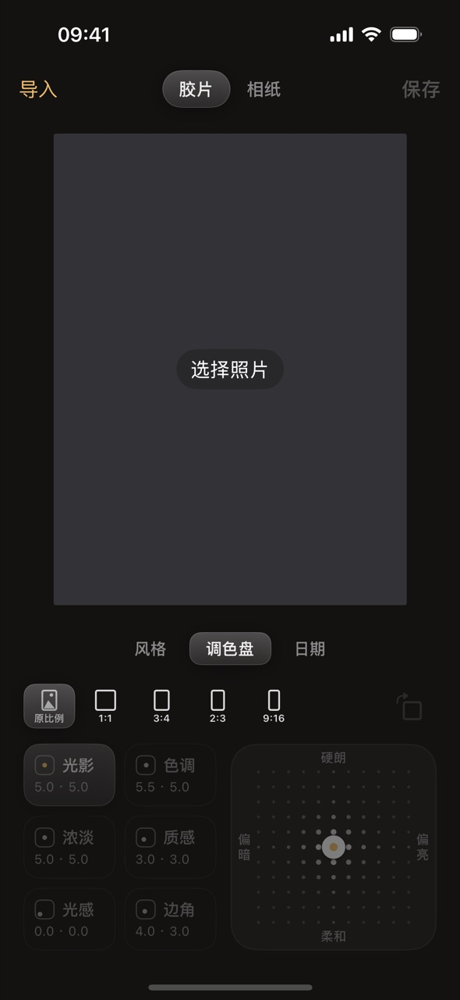 选择照片前</td>
  </tr>
</table>

## 两种模式

胶片和相纸共用同一批照片、同一个风格和同一套调色，随时可以切来切去对比效果。

<table>
  <tr>
    <td align="center"> 胶片</td>
    <td align="center">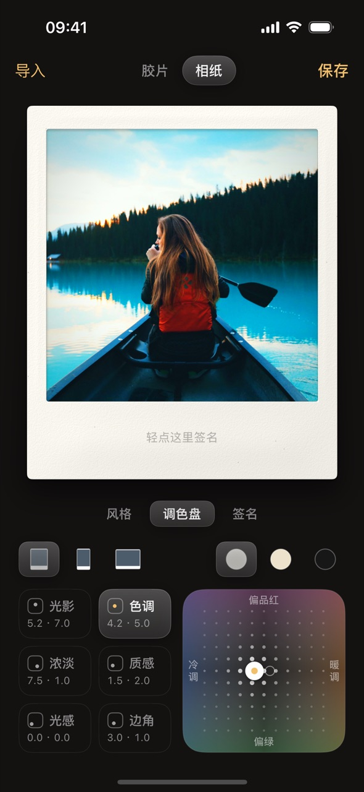 相纸</td>
  </tr>
</table>

## 风格

12 个内置风格。每个风格配一张自己的样片，套用之前就能看到效果。选中风格会一次换好整套色彩，之后还可以在调色盘里接着微调。

<table>
  <tr>
    <td align="center">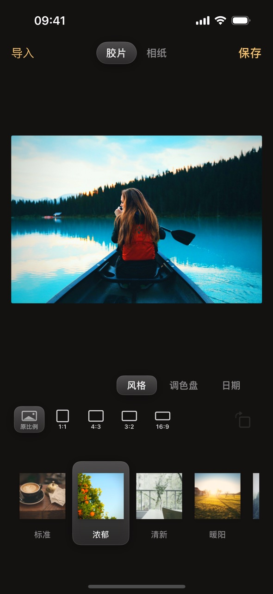 风格页，选中「浓郁」</td>
  </tr>
</table>

<table>
  <tr>
    <td>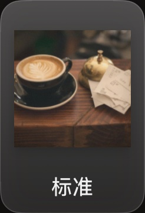</td>
    <td>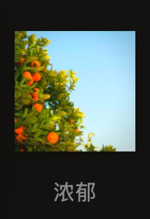</td>
    <td>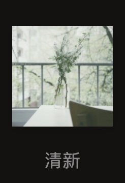</td>
    <td>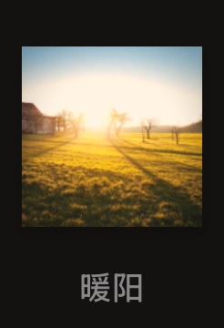</td>
    <td>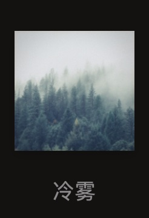</td>
    <td>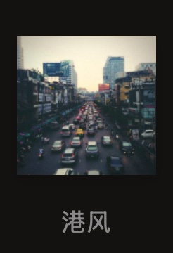</td>
  </tr>
  <tr>
    <td>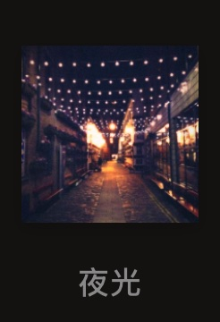</td>
    <td>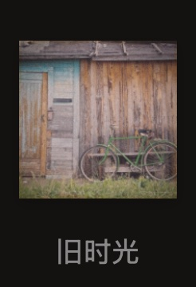</td>
    <td>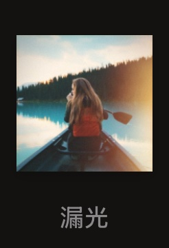</td>
    <td>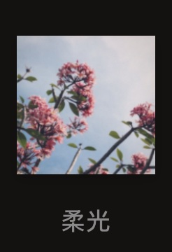</td>
    <td>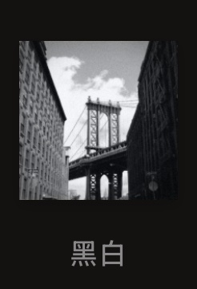</td>
    <td>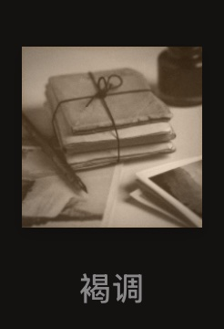</td>
  </tr>
</table>

| 风格 | 效果 |
| --- | --- |
| 标准 | 经典相纸色：黑色发灰，暗部微微偏青，亮部偏暖 |
| 浓郁 | 白平衡偏冷，色彩饱满，反差大 |
| 清新 | 略微偏亮，低对比、低饱和，带一点青绿 |
| 暖阳 | 金黄的暖调，亮处带一点光晕 |
| 冷雾 | 偏冷偏淡，柔和朦胧 |
| 港风 | 反差大，暗部偏青绿，亮部偏暖 |
| 夜光 | 灯光外面一圈红橙色光晕，暗处偏冷 |
| 旧时光 | 像过期的相纸：几乎没有反差，偏粉偏橘，边缘斑驳 |
| 漏光 | 一侧渗进红橙色的漏光 |
| 柔光 | 柔焦加光晕，粉彩色调 |
| 黑白 | 冷调黑白，颗粒感强 |
| 褐调 | 暖褐色的单色，像放了很多年的老照片 |

## 调色盘

十二项调节两两一组，放在触控板上：一项管左右，一项管上下，手指一划两项一起调。

| 分组 | 左 → 右 | 下 → 上 |
| --- | --- | --- |
| 光影 | 曝光：偏暗 → 偏亮 | 对比：柔和 → 硬朗 |
| 色调 | 冷暖：冷调 → 暖调 | 色偏：偏绿 → 偏品红 |
| 浓淡 | 饱和：黑白 → 鲜艳 | 褪色：原色 → 褪色 |
| 质感 | 柔焦：清晰 → 柔焦 | 颗粒：细腻 → 颗粒 |
| 光感 | 光晕：无光晕 → 光晕 | 漏光：无漏光 → 漏光 |
| 边角 | 暗角：通透 → 暗角 | 边缘：干净 → 斑驳 |

- 手指按到哪里，两个数值就取哪里。
- 靠近默认点会自动吸附，每跨过一格有轻微震动。
- 双击触控板，本组恢复默认。

<table>
  <tr>
    <td align="center"> 光影</td>
    <td align="center">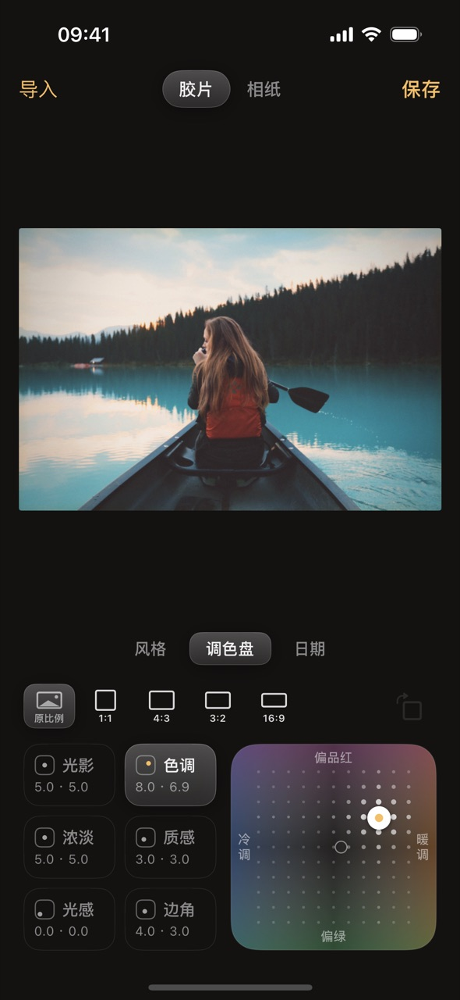 色调</td>
  </tr>
</table>

## 胶片

默认模式。照片铺满画面，保存的就是套上色彩的照片本身。

### 画面比例

原比例、1:1、4:3、3:2、16:9。比例跟着照片的方向走，选项行最右边的按钮可以切换横竖。

<table>
  <tr>
    <td align="center">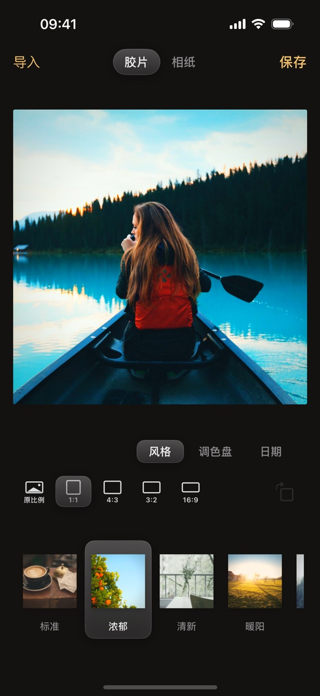 1:1</td>
  </tr>
</table>

### 日期水印

像老式胶片相机的日期后背，在右下角印一行发光的数码管日期。

- 可以印照片的拍摄日期，也可以印今天。照片没有记录拍摄日期时，改用今天。
- 三种顺序：'26 11 22、11 22 '26、22 11 '26。
- 橙色、红色、黄色三种颜色。
- 页面最下面一行写着这张照片会印上什么。

<table>
  <tr>
    <td align="center"> 日期页</td>
  </tr>
</table>

  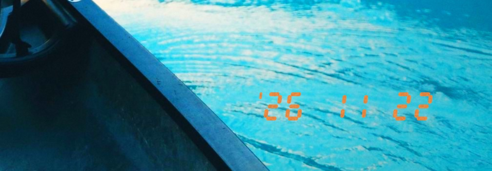 
  保存的照片上，日期水印的原尺寸

### 对比原图

按住照片显示原图，松手恢复。

<table>
  <tr>
    <td align="center">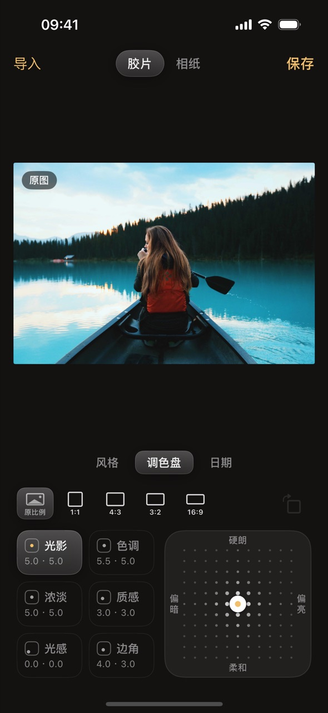 按住照片</td>
  </tr>
</table>

### 保存的照片

保存的是处理好的高分辨率照片，保留原照片的拍摄时间和地点，在相册里和原图排在一起。

  

## 相纸

照片放进相纸的取景窗里，底边留出签名的地方。

### 版式与纸色

三种版式（方形、竖幅、横幅），三种纸色（白、米、黑）。换成黑色相纸时，黑墨水自动换成白墨水。

<table>
  <tr>
    <td align="center">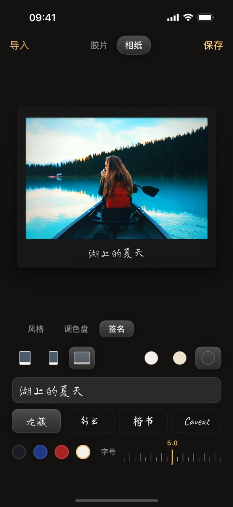 横幅、黑色相纸</td>
  </tr>
</table>

### 签名

像拿笔一样，在相纸底边写一行字。

- 轻点相纸底边的空白处，或切到「签名」。
- 四款手写字体、四色墨水（黑、蓝、红、白），字号用刻度盘调。
- 输入时只有输入框升到键盘上方，页面其余部分保持不动。

<table>
  <tr>
    <td align="center">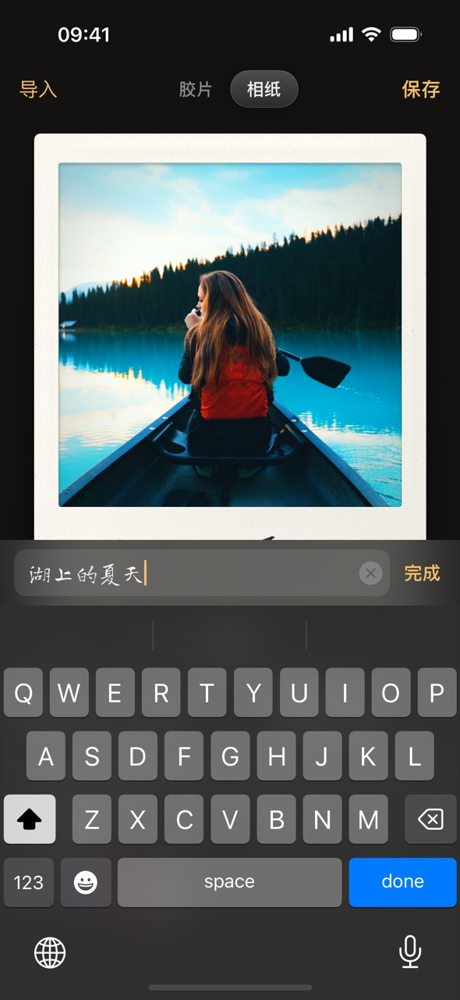 输入中</td>
    <td align="center"> 字体、墨水与字号</td>
  </tr>
</table>

### 相纸质感

纸面参照实物相纸的结构：缎面哑光的边框，四角微圆、带内阴影的取景窗，光面的照片区。成片放大到原尺寸，细节依然经得起看。

  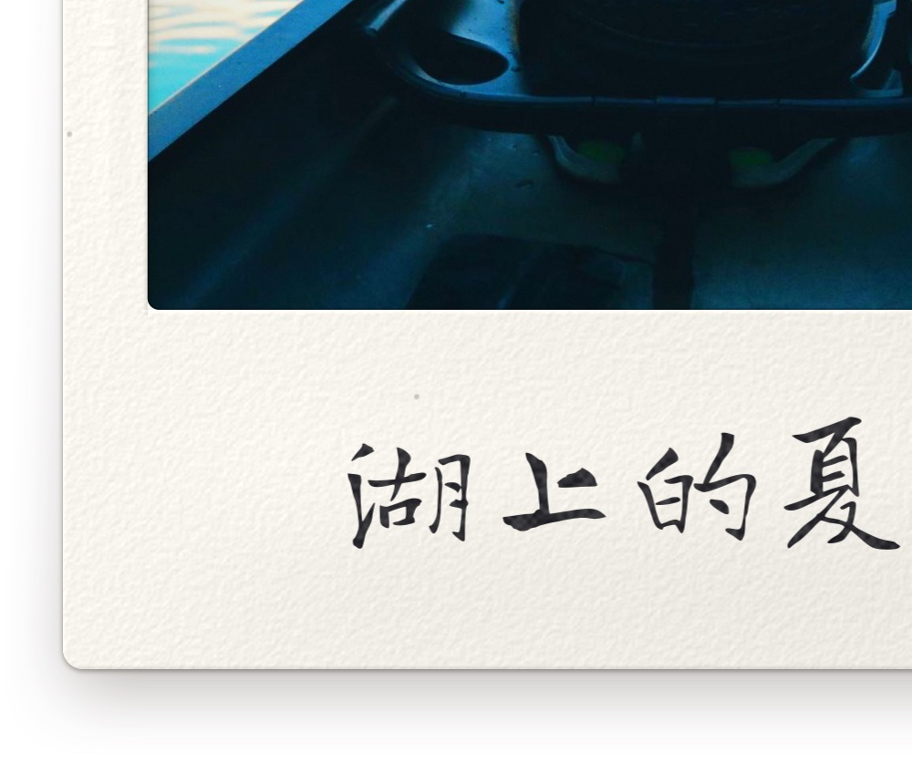 
  成片左下角原尺寸

### 相纸成片

保存的成片是一张放在白色桌面上的相纸：四角微圆，带柔和的阴影，分辨率高。

  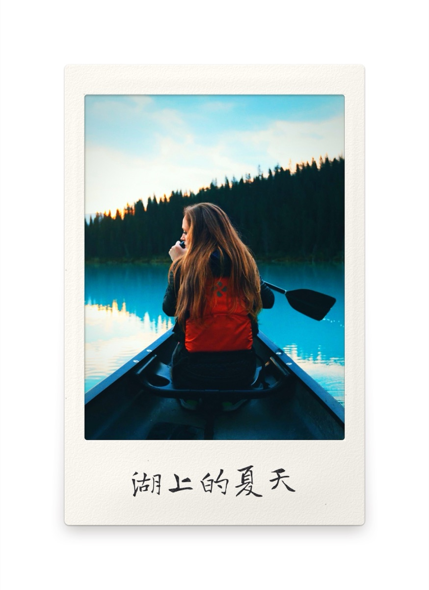

## 批量导入

一次最多导入 20 张。照片下方出现一排缩略图，点哪张就编辑哪张。模式、风格、调色和日期水印对所有照片都生效，裁切每张各自保留。保存时可以全部保存，也可以只存当前这张。

<table>
  <tr>
    <td align="center">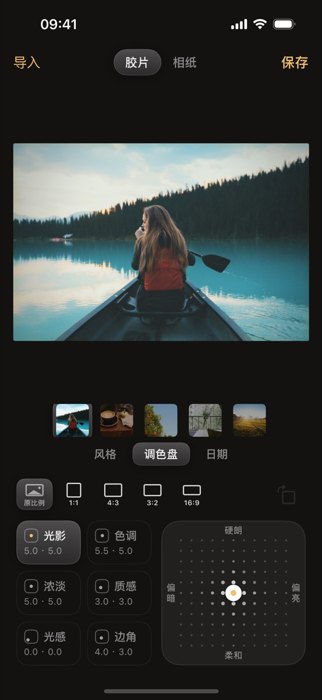 一次导入多张</td>
  </tr>
</table>

## 界面语言

支持简体中文和英文，跟随 iPhone 的语言：简体中文显示中文，其他语言一律显示英文。也可以在「设置 → CineBL → 语言」里给 CineBL 单独选语言。

<table>
  <tr>
    <td align="center"> 简体中文</td>
    <td align="center"> 英文</td>
  </tr>
</table>

## 隐私

不需要注册账号，不收集任何数据。用系统照片选择器选图，App 读不到你的相册；只在保存时请求「添加照片」权限。保存的照片保留原照片的拍摄时间和地点。

## 系统要求

iOS 16.0 及以上的 iPhone。
